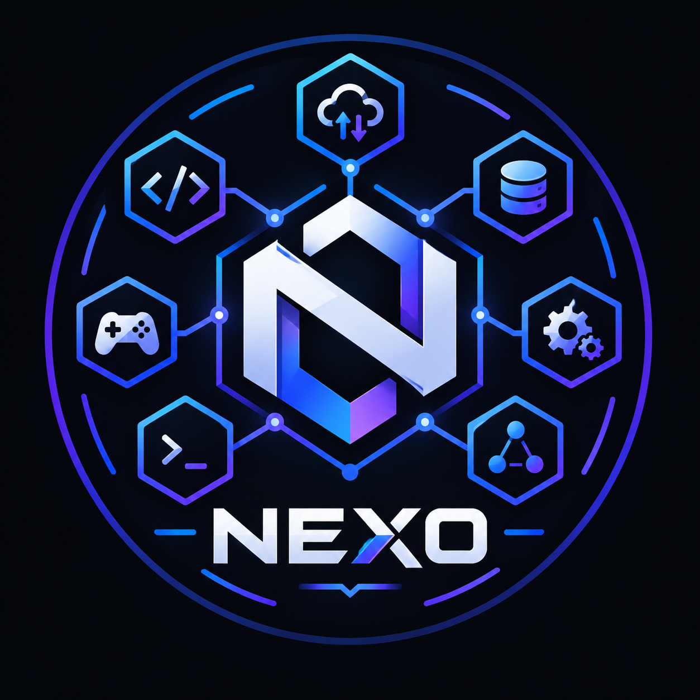

<div align="center">
   
</div>

# NEXO — Discord Bot

**Conectando sistemas, automatizando tarefas e expandindo as possibilidades da sua comunidade.**

O NEXO é um bot multifuncional para Discord, desenvolvido com foco em integração, automação e extensibilidade. Sua proposta é centralizar diferentes funcionalidades em uma única aplicação, conectando APIs, serviços, dados e ferramentas para oferecer uma experiência mais prática e organizada dentro de servidores Discord.

O projeto também busca aplicar boas práticas de desenvolvimento de software, com código organizado, arquitetura modular e possibilidade de expansão conforme novas funcionalidades são desenvolvidas.

---

## 🔗 Sobre o projeto

O NEXO nasceu da ideia de criar um ponto de conexão entre diferentes funcionalidades e serviços dentro do Discord.

Em vez de limitar o bot a uma única finalidade, o projeto busca construir uma base modular que permita adicionar recursos independentes, integrar serviços externos e automatizar processos sem comprometer a organização do código.

O desenvolvimento é orientado por três princípios:

- **Integração:** conectar APIs, serviços e sistemas distintos.
- **Automação:** reduzir tarefas manuais por meio de comandos e processos automatizados.
- **Extensibilidade:** facilitar a criação e a manutenção de novas funcionalidades.

## 🎯 Objetivos

- Desenvolver um bot multifuncional para utilização pessoal.
- Criar uma arquitetura organizada e modular.
- Implementar comandos independentes e reutilizáveis.
- Explorar integrações com APIs e serviços externos.
- Aplicar conceitos de programação assíncrona, tratamento de erros e organização de projetos.
- Evoluir continuamente o projeto com funcionalidades técnicas e gamers.

## ⚙️ Funcionalidades

O conjunto de funcionalidades será ampliado conforme o desenvolvimento do projeto.

### Planejadas

- [ ] Carregamento automático de comandos.
- [x] Integração com APIs externas.
- [ ] Automações para tarefas recorrentes.
- [ ] Ferramentas de administração e moderação.
- [ ] Sistema de logs e tratamento de erros.
- [ ] Configurações personalizáveis por servidor.
- [ ] Integrações com serviços e plataformas externas.

> Os itens acima representam o planejamento do projeto, não necessariamente funcionalidades já implementadas.

## 🛠️ Tecnologias

| Tecnologia | Finalidade |
|---|---|
| [Node.js](https://nodejs.org/) | Ambiente de execução JavaScript |
| [JavaScript](https://developer.mozilla.org/docs/Web/JavaScript) | Linguagem principal |
| [Discord.js](https://discord.js.org/) | Integração com a API do Discord |
| [Discord Developer Portal](https://discord.com/developers/applications) | Criação e configuração da aplicação |
| [Git](https://git-scm.com/) | Controle de versão |
| [GitHub](https://github.com/) | Hospedagem e documentação do código |

*As tecnologias listadas devem ser ajustadas conforme as dependências efetivamente utilizadas no projeto.*

## 📋 Pré-requisitos

Antes de executar o NEXO, você precisará de:

- Node.js em uma versão compatível com a versão do Discord.js instalada.
- npm, incluído na instalação do Node.js.
- Git, para clonar o repositório.
- Uma aplicação e um bot configurados no Discord Developer Portal.

## 🚀 Instalação

### 1. Clone o repositório

```bash
git clone https://github.com/SEU-USUARIO/NEXO.git
```

Entre na pasta do projeto:

```bash
cd NEXO
```

Substitua `SEU-USUARIO/NEXO` pelo endereço real do repositório.

### 2. Instale as dependências

```bash
npm install
```

### 3. Configure as variáveis de ambiente

Crie um arquivo `.env` na raiz do projeto:

```env
DISCORD_BOT_TOKEN=seu_token_aqui
DISCORD_BOT_ID=id_da_aplicacao
GUILD_TESTE_ID=id_do_servidor_de_teste
STEAM_API_KEY=steam_api_key
```

Essas variáveis são exemplos de configuração. Mantenha apenas as que o código realmente utiliza.

### 4. Configure o bot no Discord

1. Acesse o [Discord Developer Portal](https://discord.com/developers/applications).
2. Crie uma aplicação ou selecione a aplicação existente.
3. Acesse a seção **Bot** e configure o bot.
4. Copie o token e armazene-o na variável de ambiente correspondente.
5. Configure os escopos e as permissões necessários para os recursos implementados.
6. Gere um link de instalação e adicione o bot ao seu servidor de testes.

Conceda somente as permissões necessárias. Intents privilegiados devem ser habilitados apenas se forem exigidos pelo código.

## ▶️ Execução

O comando depende dos scripts definidos no `package.json`.

Caso exista um script `start`, execute:

```bash
npm start
```

## 📁 Estrutura do projeto

Uma possível organização modular para o NEXO é:

```text
NEXO/
├── src/
│   ├── commands/
│   │   ├── general/
│   │   ├── utility/
│   │   └── moderation/
│   ├── events/
│   ├── handlers/
│   │   └── CommandHandler.js
│   ├── services/
│   ├── utils/
│   └── config/
├── .env.example
├── .gitignore
├── index.js
├── package.json
├── package-lock.json
└── README.md
```

Essa estrutura é uma sugestão de organização, não uma representação confirmada dos arquivos atuais do repositório.

### Responsabilidades dos diretórios

- `src/commands`: módulos que implementam os comandos do bot.
- `src/events`: tratamento de eventos emitidos pelo Discord.js.
- `handlers/`: carregamento e registro de comandos e outros módulos.
- `services/`: integrações com APIs e regras de negócio reutilizáveis.
- `utils/`: funções auxiliares compartilhadas.
- `config/`: configurações não sensíveis da aplicação.
- `index.js`: ponto de entrada responsável por inicializar o bot.


## 📄 Licença

A licença do NEXO ainda deve ser definida.
Se a intenção for permitir que outras pessoas utilizem, modifiquem e distribuam o projeto, escolha uma licença compatível com esses objetivos e adicione o arquivo `LICENSE` à raiz do repositório.

Não presuma que o projeto é open-source apenas por estar hospedado publicamente no GitHub: a licença determina quais permissões são concedidas aos usuários.

## 👨‍💻 Autor

Desenvolvido por **Filipe Silveira**.

Projeto pessoal voltado ao desenvolvimento de bots para Discord, integração de sistemas, automação e aplicação de boas práticas de engenharia de software.

---

<p align="center">
  <strong>NEXO</strong><br>
  Conectando tecnologia, automação e comunidade.
</p>
